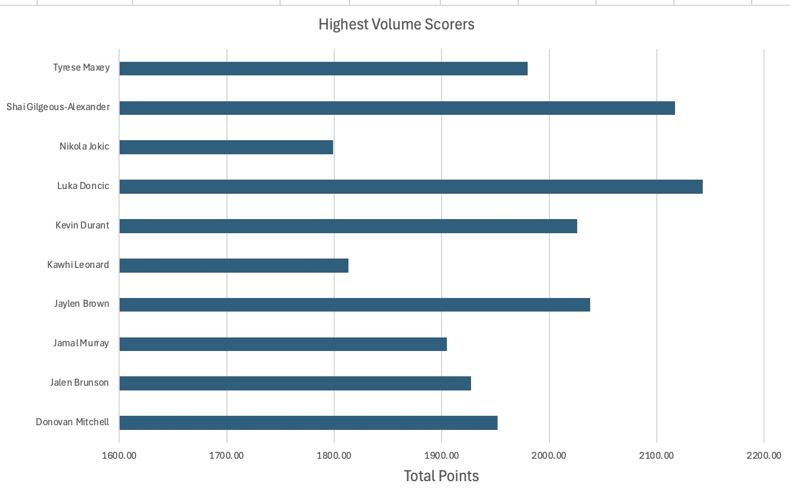
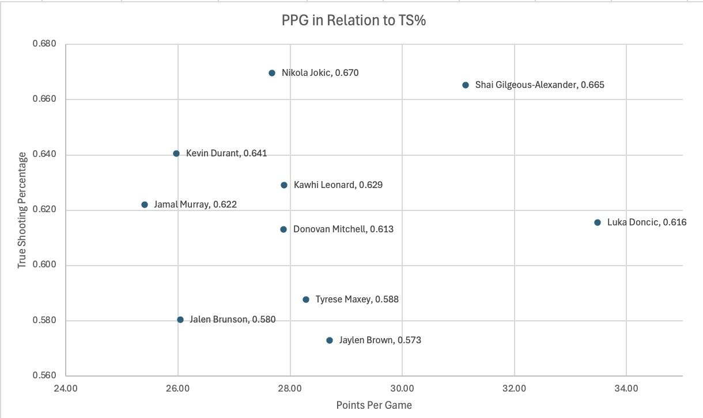
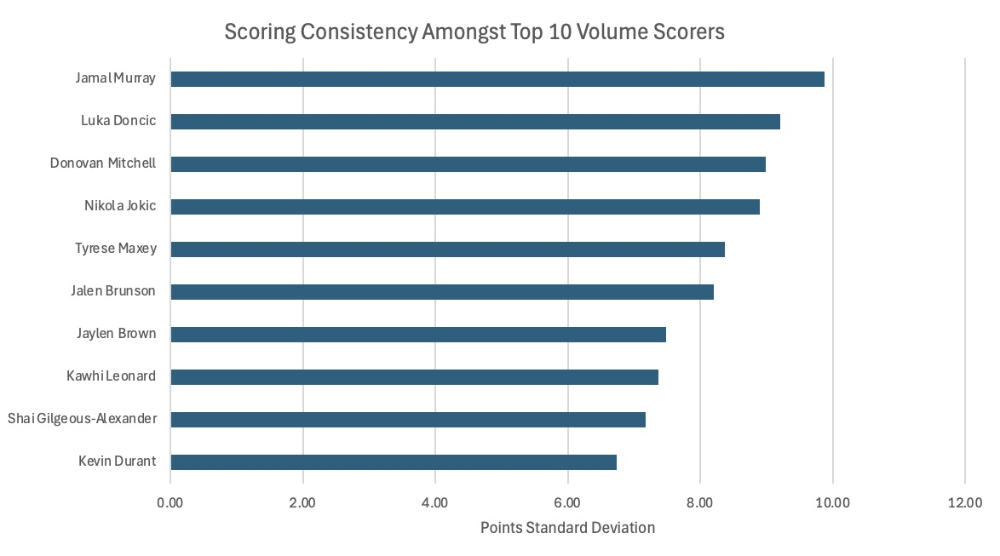
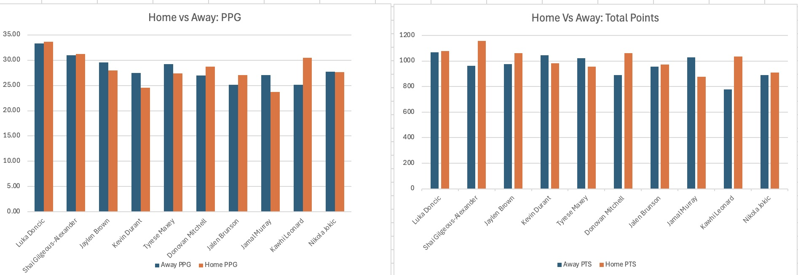
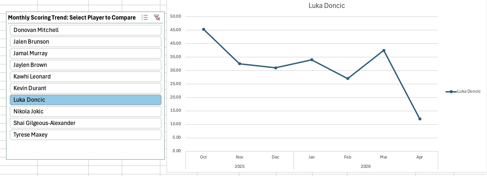

# 2025-2026 NBA Player Performance & Efficiency Analysis

## Overview
This project analyzes game-level NBA player data in Microsoft Excel to evaluate scoring volume, efficiency, consistency, home/away performance, and changes in scoring throughout the season.

The analysis focuses on the ten highest-volume scorers identified by total points and follows the same player cohort throughout the project.

## Questions
1. Who are the highest-volume scorers?
2. Which high-volume scorers are most efficient?
3. Which high-volume scorers are most consistent?
4. How does scoring performance differ between home and away games?
5. How does scoring performance change throughout the season?

## Methodology
- Question 1 identified the top 10 players by total points. Questions 2–5 then used this fixed cohort to compare scoring efficiency, consistency, home/away performance, and monthly scoring trends.

## Tools & Techniques
- Microsoft Excel
- PivotTables and PivotCharts
- Slicers
- Calculated metrics
- True Shooting Percentage (TS%)
- Standard deviation
- Data filtering and aggregation
- Bar, scatter, and line charts

## Analysis

### 1. Highest-Volume Scorers

Luka Dončić led the selected players in both total scoring volume and points per game.

### 2. Scoring Efficiency

Nikola Jokić recorded the highest TS% among the top-volume scorers, while Shai Gilgeous-Alexander combined similarly strong efficiency with greater scoring volume.

### 3. Scoring Consistency

Kevin Durant recorded the lowest game-to-game scoring standard deviation among the selected players.

### 4. Home vs Away Performance

Home/away effects varied substantially by player rather than showing one consistent group-wide advantage.

### 5. Monthly Scoring Trends

Scoring changed throughout the season, with different players showing different month-to-month patterns.

## Workbook
The Excel workbook contains:
- Raw game-level data
- Highest Volume Scorers
- Most Efficient Scorers
- Most Consistent Scorers
- Home vs Away Performance
- Monthly Scoring Trends

[Download/View the Excel workbook](./NBA_Player_Performance_Analysis.xlsx)

## Data Source
- [NBA Player Stats – 2025–26 Season (Kaggle)](https://www.kaggle.com/datasets/eduardopalmeiri/nba-player-stats-season-2526](https://www.kaggle.com/datasets/eduardopalmieri/nba-player-stats-season-2526))
